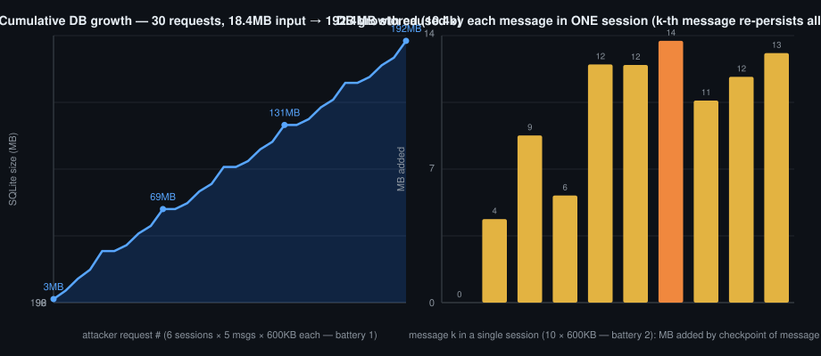

# LangChain Agent Persistence Flood — Security Lab

**Persistent storage-exhaustion attack against the default LangChain/LangGraph agent persistence pattern (`create_agent` + `SqliteSaver`), reproduced with the exact methodology of a prior n8n execution-data flood lab.**



**TL;DR — the headline finding:** the checkpointer writes a full checkpoint (the *entire* conversation) on every superstep. An attacker who controls message size therefore gets **quadratic storage growth per session**: message *k* persists ~*k*× its own payload. **18.4 MB of attacker input became 192.4 MB on disk — a 10.4× amplification** (the same attack against n8n amplified 2.3×, linearly). It persists even when the LLM call fails or times out, survives restarts, and the DELETE API reclaims **0 bytes** — only a `VACUUM` does.

- **Tested:** 2026-10-29 · langchain **1.4.7**, langchain-core **1.7.1**, langgraph **1.2.18**, langgraph-checkpoint-sqlite **3.1.2** · Python 3.14.7 · Ubuntu 24.04 (WSL2)
- **Scope:** 100% local lab (localhost victim, attacker scripts on the same box). No third-party systems were touched.
- **Full methodology:** [docs/METHODOLOGY.md](docs/METHODOLOGY.md) · **Raw evidence:** [evidence/](evidence/) · **Run logs:** [logs/](logs/)

---

## What this is (and isn't)

This is a **defender-oriented security research artifact**: a reproducible lab that measures how the *default* agent persistence pattern behaves when message size is attacker-controlled. It documents the mechanism, the exact versions, the measurement methodology, and mitigations.

**Honest framing:** this is not a CVE and not a code-level bug in LangChain. Checkpointing the full state every superstep is the intended design of a checkpointer; the risk is that (a) nothing bounds attacker-controlled input by default, and (b) the write pattern turns *linear input into quadratic storage*. It is a **design-level resource-exhaustion risk** in the most common deployment pattern from the docs. Deployments that let untrusted users send arbitrary-size messages to an agent with a SQLite (or any full-history) checkpointer inherit it.

## The attack surface

The victim is a minimal support-chatbot, exactly the docs pattern:

- FastAPI app exposing `POST /chat {session_id, message}` → agent `create_agent(model, tools=[], checkpointer=SqliteSaver(...))`
- `thread_id` = attacker-supplied `session_id`
- Process memory capped with `RLIMIT_AS 2.5GB` (same envelope as the prior n8n heap lab)
- LLM behind an OpenAI-compatible endpoint (glm-5.3-flash); **the persistence happens pre-LLM**, so the storage finding is model-independent

```python
_saver = SqliteSaver(sqlite3.connect(DB_PATH, check_same_thread=False))
agent = create_agent(_llm, tools=[], checkpointer=_saver)   # victim/victim_app.py
```

## Results (measured, raw JSON in `evidence/`)

| Finding (n8n lab ID) | n8n (2.45.5, 2026-10-28 lab) | LangChain 1.4.7 stack | Verdict |
|---|---|---|---|
| **F-014 storage flood** | 18 MB input → +41 MB DB (**2.3×, linear**) | 18.4 MB input → **+192.4 MB (10.4×)**, growth is **O(n²) per session** | ✅ **Replicates — and it's worse** |
| **F-014 delete vs space** | API delete reclaims 0 B; only offline `VACUUM` | Identical: DELETE → **0 B** (freelist), `VACUUM` + `wal_checkpoint(TRUNCATE)` reclaims 37.9 MB | ✅ Replicates (mechanically identical) |
| **F-013 heap (parse of all state)** | Parsing ~30 large executions in the main process → fatal OOM at 2.5 GB heap | Loading all flooded sessions' full state 3× round: server alive, VmHWM plateaued at **235 MB** | ❌ Does not replicate |
| **F-005 empty-success** | Inputs ≥ ~8 KB → `content=''`, `finish_reason=length`, reported as success | 0 empty-successes at `max_tokens=4096`; instead **server-side LLM timeouts** at 2–16 KB (~190 s to fail), returned as clean errors | ❌ Does not replicate (new finding) |

### Why the storage amplification is quadratic

`SqliteSaver` writes one checkpoint per superstep, and each checkpoint contains **the whole message list so far**. Sending message *k* therefore serializes ~*k*× its payload:

- 6 sessions × 5 messages × 600 KB = 18.4 MB sent → **192.4 MB** DB (battery 1, `evidence/battery1_storage_flood.json`, per-request trace included)
- One session × 10 messages × 600 KB = 6 MB sent → **+92 MB** for that session alone (battery 2 trace: per-message delta grows from ~4 MB to ~13 MB as the conversation deepens)
- The LLM is irrelevant to the write cost: input is checkpointed **before** inference; persistence is identical whether the LLM answers, times out, or errors
- Attack economics: no auth, one HTTP request per message, disk fills permanently (`SQLITE_FULL` → app crash-loop) with zero reclaimable space via the API

### Measurement gotchas worth copying (also in METHODOLOGY.md)

- **WAL inflates post-`VACUUM` reads:** reading the DB file immediately after `VACUUM` *shows growth* (284 → 494 MB) because `VACUUM` output flows through the WAL. Measure after `PRAGMA wal_checkpoint(TRUNCATE)` — real total 246.6 MB, 37.9 MB reclaimed.
- DELETE reclaims 0 bytes even though `PRAGMA freelist_count` rises (7,544 pages); the file only shrinks on `VACUUM`.
- `> file` logging in long batteries is block-buffered; run `python -u` or your heartbeats lie.

## Reproduce it

```bash
python -m venv .venv && source .venv/bin/activate
pip install -r requirements.txt

export LLM_API_KEY=sk-...            # any OpenAI-compatible endpoint
export LLM_BASE_URL=https://api.openai.com/v1   # default is Z.AI coding endpoint
export VICTIM_MODEL=gpt-4o-mini      # default: glm-5.3-flash

# terminal 1 — victim on 127.0.0.1:8124 with a 2.5GB address-space cap
python victim/server_wrapper.py

# terminal 2 — batteries (each writes evidence/<name>.json)
cd attacks
python -u battery1_storage_flood.py   # storage flood: 6 sess × 5 × 600KB → amplification
python -u battery2_heap.py            # heap: flood 1 session, then load ALL sessions ×3
python -u battery3_delete_vacuum.py   # delete vs VACUUM (run after 1)
python -u battery4_f005.py            # empty-success / LLM timeout thresholds
python consolidate.py                 # regenerates evidence/COMPARATIVA_N8N.json
```

`attacks/probe_api.py` and `attacks/probe_thinking.py` are optional direct-to-provider probes (payload acceptance, thinking on/off timing).

## Mitigations (for defenders)

None of these exist by default; all are config/architecture level:

1. **Cap input before it reaches the agent** — reverse-proxy body limit and/or app-level validation. This is the single effective control: the checkpointer stores whatever the request carried.
2. **Bound the conversation** — trim/truncate the message list before invoke (or use a rolling-window checkpointer) so checkpoint size stops growing with history depth; that converts O(n²) into O(n).
3. **Fuse the disk — but handle the failure it creates.** `PRAGMA max_page_count` on the SQLite file stops the growth, but it fails closed: the checkpointer write raises `SQLITE_FULL` ("database or disk is full"). Catch it around the invoke and degrade that single request — the write path, never the worker. Unhandled, the fuse becomes the outage: restart → first write trips the cap → crash-loop. Measured on a capped WAL database: the error surfaces in the INSERT path (not at checkpoint time), the `-wal` file does *not* balloon past the cap (0 bytes growth across repeated failed writes), reads keep working, deleted pages are only partially reusable — reliable recovery wants a `VACUUM`, which does succeed online under the cap. Still strictly better than volume-full: only this app errors while the host stays healthy. Add a filesystem quota on the state directory as the second layer.
4. **Retention** — TTL/prune of threads and scheduled `VACUUM` (offline, with the WAL caveat above).
5. **Mint thread IDs server-side; alert on the file, not the thread.** Client-chosen thread IDs let a flood of *short* threads keep every per-thread growth curve flat while the shared file hits its cap — our own lab victim passed `session_id` straight through as `thread_id`, which is exactly that gameable pattern. Reject unknown IDs before any checkpointer write, rate-limit session creation, and make the primary alert the DB file's growth rate. Per-thread alerts are a weak secondary signal at best.
6. **Know what SQLite can't give you: write concurrency.** SQLite serializes writers — one stuck or oversized checkpoint transaction blocks every other session's writes even with free pages (WAL readers stay unaffected). The fuse in #3 protects data, not availability. For concurrent traffic with full-history persistence, use a checkpointer backend with real space management and row-level locking (e.g. Postgres + table quotas).

## Prior work: the n8n lab

The methodology (envelope, payload shape, battery design, evidence schema) is a direct port of a private 2026-10-28 lab against **n8n 2.45.5**, where attacker-controlled webhook payloads persisted verbatim in `execution_data` (2.3× linear amplification) and parsing them with `includeData=true` crashed the platform's main process at a 2.5 GB heap. The LangChain results above are the cross-framework comparison; the side-by-side summary is in [`evidence/COMPARATIVA_N8N.json`](evidence/COMPARATIVA_N8N.json).

## Repository layout

```
├── victim/            # the local "support chatbot" (FastAPI + create_agent + SqliteSaver)
├── attacks/           # battery scripts 1-4 + provider probes + consolidation
├── evidence/          # raw JSON results from the 2026-10-29 run (committed as-is)
├── logs/              # raw stdout of the batteries (paths trimmed)
├── docs/METHODOLOGY.md  # full method: envelope, seeds, rigor rules, gotchas
└── docs/img/          # figure generated from evidence JSONs
```

## Responsible use

Everything here runs against a **local, self-owned** victim on loopback. Do not point these techniques at systems you don't own or lack written authorization to test. See [DISCLAIMER.md](DISCLAIMER.md).

## License

MIT — see [LICENSE](LICENSE).
